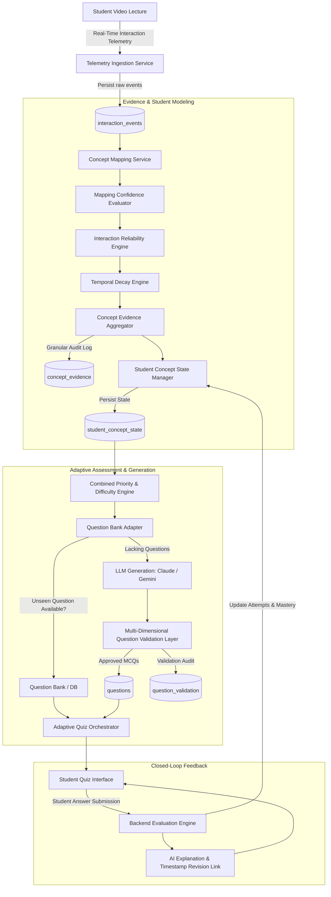

# CogniTrace System Architecture

## Overview
CogniTrace is an intelligent learning analytics and closed-loop adaptive assessment platform. It captures granular educational-video telemetry, maps events to curricular concepts, derives reliability-weighted and temporally-decayed evidence scores, maintains authoritative concept-level student states, and delivers dynamically adaptive assessments with multi-dimensional question validation.

---

## 1. System Architecture Diagram



---

## 2. Component Directory Structure

```text
backend/app/
├── api/
│   ├── deps.py                       # Auth & role dependencies
│   └── v1/
│       ├── auth.py                   # Authentication
│       ├── courses.py                # Course management
│       ├── telemetry.py              # Telemetry ingestion (/student/events)
│       ├── transcripts.py            # Whisper transcript generation
│       ├── concepts.py               # Concept extraction
│       ├── questions.py              # Question bank management
│       ├── quiz.py                   # Adaptive quiz endpoints (/quiz/*)
│       ├── student_courses.py        # Student course access & adaptive quiz
│       └── research.py               # Research config, metrics, & student states
├── core/
│   ├── config.py                     # App settings
│   ├── quiz_config.py                # Base quiz settings
│   ├── research_config.py            # Evidence weights, lambda, ablation presets
│   └── security.py                   # JWT & password hashing
├── db/
│   └── mongodb.py                    # Mongo connection, client pooling, index init
├── repositories/
│   └── quiz_session_repository.py    # Quiz session persistence
├── schemas/
│   ├── evidence.py                   # Granular evidence audit models
│   ├── student_state.py              # Concept state & mastery models
│   ├── validation.py                 # Question validation models
│   ├── research.py                   # Evaluation metrics & ablation reports
│   └── quiz.py                       # Quiz sessions, safe questions, responses
└── services/
    ├── evidence_engine.py            # Reliability weights, confidence, temporal decay
    ├── student_state_service.py      # Mastery scoring, priority ranking, closed loop
    ├── question_validation_service.py # Structural, semantic, quality validation
    ├── research_analytics_service.py # Accuracy, F1, learning gains, ablation
    ├── adaptive_quiz_service.py      # Adaptive assessment orchestrator
    ├── question_service.py           # Question generation & database banking
    ├── mapping_service.py            # Telemetry to concept boundary mapping
    ├── claude_service.py             # LLM MCQ generation prompt pipeline
    └── explanation_service.py        # Post-submission AI explanations
```

---

## 3. Database Collections & Indexing

| Collection | Key Fields | Indexes | Description |
|---|---|---|---|
| `interaction_events` | `StudentID`, `CourseID`, `EventType`, `EventTimestamp` | `StudentID`, `CourseID`, `created_at` | Raw telemetry clickstream |
| `concept_evidence` | `student_id`, `course_id`, `concept_id`, `event_time` | `(student_id, course_id)`, `event_time` | Granular intermediate evidence audit logs |
| `student_concept_state` | `student_id`, `course_id`, `concept_id`, `mastery_score` | `(student_id, course_id, concept_id)` UNIQUE | Authoritative student concept states |
| `questions` | `course_id`, `concept_ref`, `question_hash`, `difficulty` | `(course_id, question_hash)` UNIQUE | Validated question bank |
| `question_validation` | `course_id`, `concept_id`, `question_hash`, `status` | `(course_id, concept_id)`, `question_hash` | Question validation audit trail |
| `quiz_sessions` | `quiz_session_id`, `student_id`, `course_id`, `status` | `quiz_session_id` UNIQUE, `(student_id, course_id)` | Quiz session state machine |
